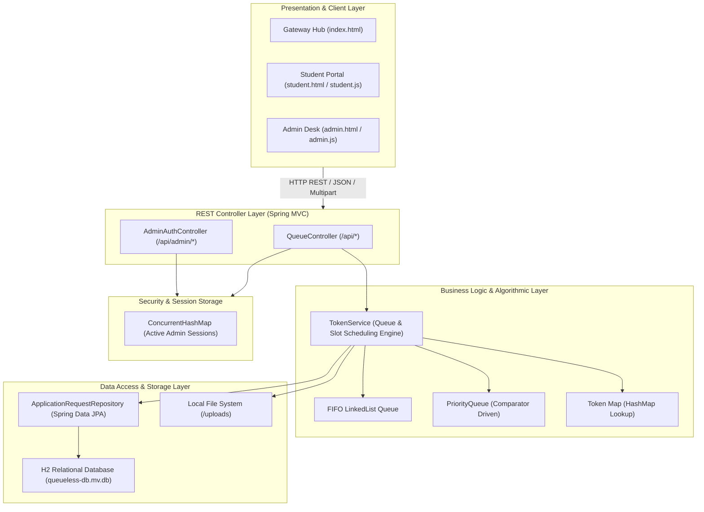
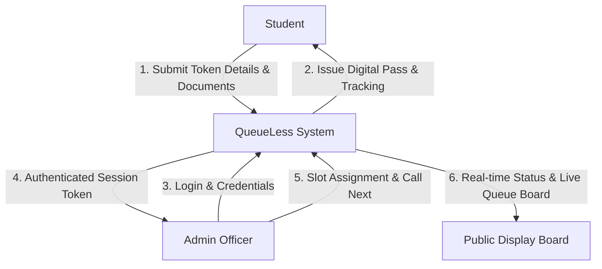
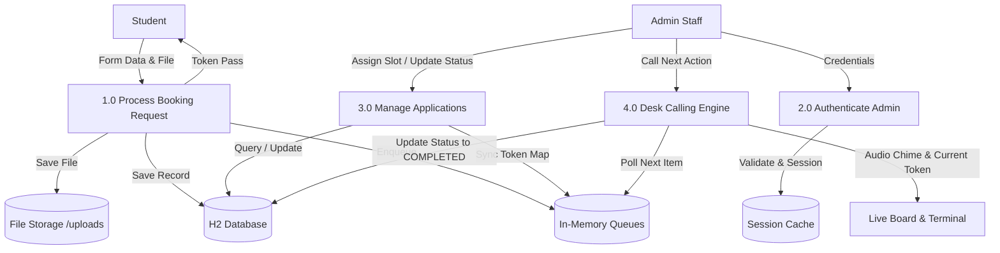
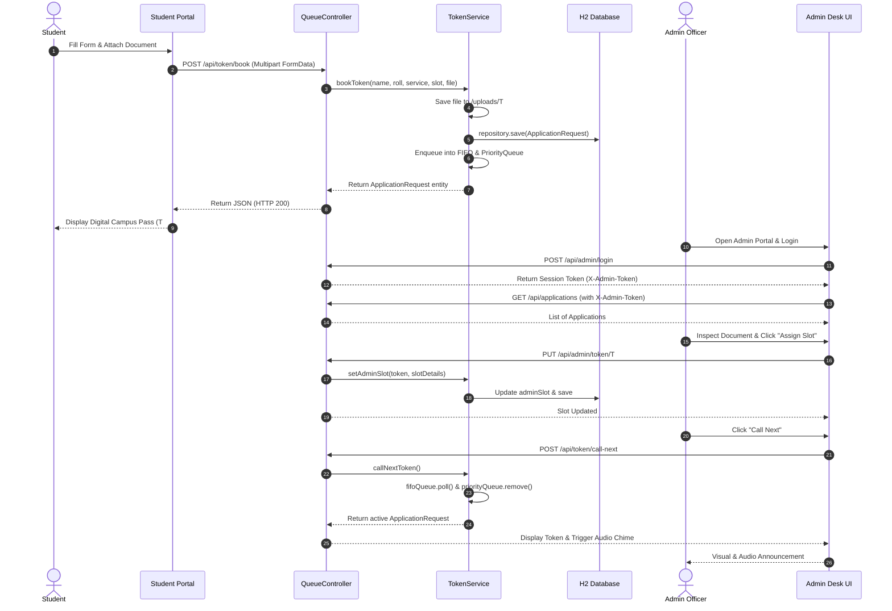
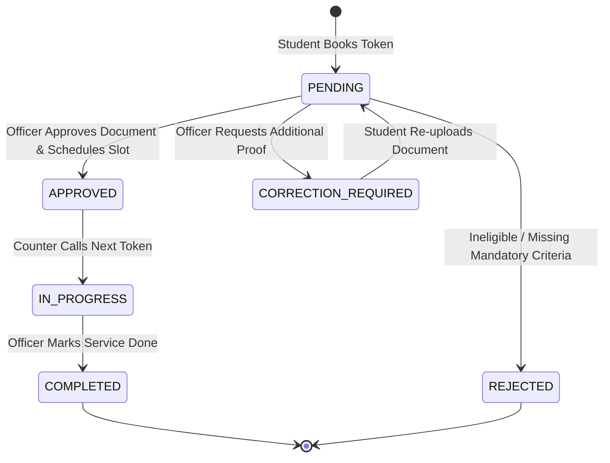
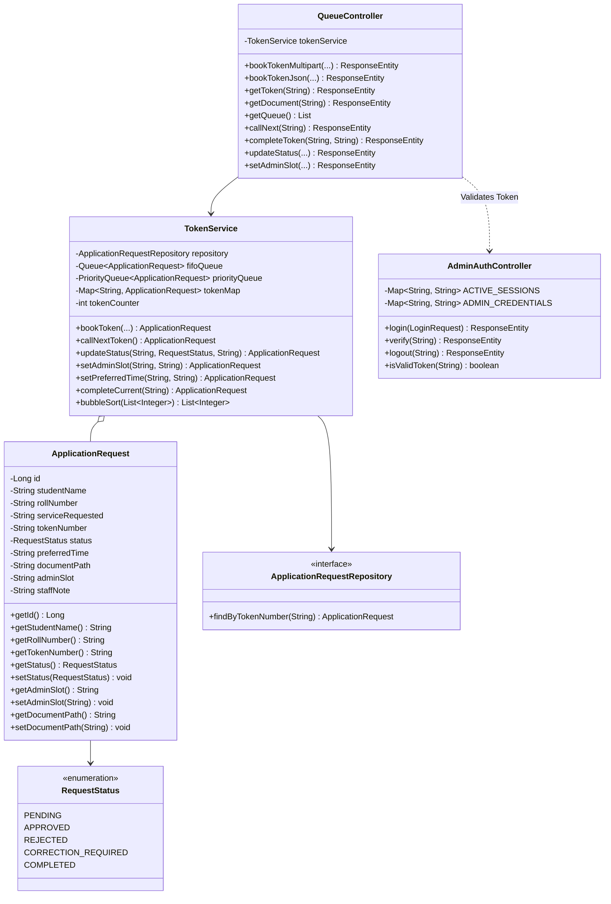
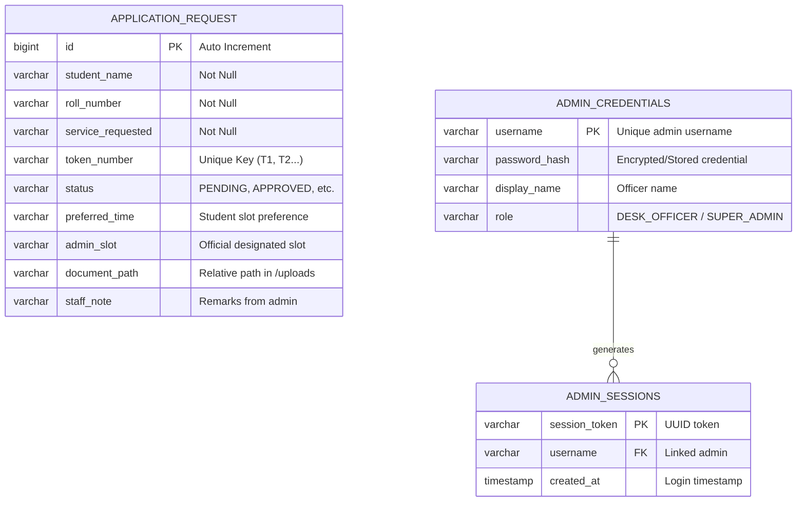

# ACADEMIC PROJECT REPORT

---

# **QueueLess: Smart Campus Queue & Digital Slot Scheduling System**

**A Comprehensive Software Engineering Project Report**  
*Submitted in partial fulfillment of the requirements for the degree of Bachelor of Technology / Bachelor of Computer Applications / Master of Computer Applications in Computer Science & Engineering*

---

## **TABLE OF CONTENTS**

1. [Certificate of Authenticity](#1-certificate-of-authenticity)
2. [Candidate Declaration](#2-candidate-declaration)
3. [Acknowledgements](#3-acknowledgements)
4. [Executive Summary / Abstract](#4-executive-summary--abstract)
5. [Chapter 1: Introduction](#chapter-1-introduction)
   - 1.1 Project Overview
   - 1.2 Problem Statement
   - 1.3 Objectives
   - 1.4 Project Scope & Limitations
6. [Chapter 2: Literature Survey & Existing vs. Proposed System](#chapter-2-literature-survey--existing-vs-proposed-system)
   - 2.1 Analysis of Traditional Physical Queues
   - 2.2 Shortcomings in Campus Administration
   - 2.3 Proposed Solution: QueueLess Architecture
   - 2.4 Comparative Analysis
7. [Chapter 3: System Requirements Specification (SRS)](#chapter-3-system-requirements-specification-srs)
   - 3.1 Functional Requirements
   - 3.2 Non-Functional Requirements
   - 3.3 Hardware Specifications
   - 3.4 Software Specifications & Technology Stack
8. [Chapter 4: System Architecture & System Design](#chapter-4-system-architecture--system-design)
   - 4.1 Layered MVC Architectural Pattern
   - 4.2 Data Flow Diagram (DFD Level 0 & Level 1)
   - 4.3 UML Sequence Diagram
   - 4.4 State Machine Diagram (Token Lifecycle)
   - 4.5 Class Diagram
9. [Chapter 5: Data Structures & Algorithmic Design](#chapter-5-data-structures--algorithmic-design)
   - 5.1 FIFO Queue Implementation
   - 5.2 Priority Queue Implementation
   - 5.3 O(1) Fast Token & Session Lookup (Hash Tables)
   - 5.4 Algorithmic Complexity Table
   - 5.5 Demonstration Sorting Algorithm (Bubble Sort)
10. [Chapter 6: Database Design & Data Dictionary](#chapter-6-database-design--data-dictionary)
    - 6.1 Database Engine: Embedded H2 SQL Engine
    - 6.2 Entity-Relationship (ER) Diagram
    - 6.3 Data Dictionary (`APPLICATION_REQUEST` Table Schema)
11. [Chapter 7: Implementation Details & Code Modules](#chapter-7-implementation-details--code-modules)
    - 7.1 Backend Micro-Architecture (Spring Boot)
    - 7.2 Administrative Security & Role-Based Access Control (RBAC)
    - 7.3 Multipart File Upload & Document Serving Pipeline
    - 7.4 Web Audio API Chime & Voice Synthesis
    - 7.5 REST API Specifications
12. [Chapter 8: User Interface & Workflow Walkthrough](#chapter-8-user-interface--workflow-walkthrough)
    - 8.1 Unified Gateway Hub
    - 8.2 Student Token Booking & Slot Customizer
    - 8.3 Digital Campus Pass & Receipt Printing
    - 8.4 Administrative Workstation & Slot Allocation Modal
    - 8.5 Live Counter Calling Center & Announcement Board
13. [Chapter 9: Testing & Quality Assurance](#chapter-9-testing--quality-assurance)
    - 9.1 Testing Strategy
    - 9.2 Test Cases & Execution Matrix
14. [Chapter 10: Conclusion & Future Scope](#chapter-10-conclusion--future-scope)
    - 10.1 Conclusion
    - 10.2 Future Roadmap
15. [References & Bibliography](#references--bibliography)

---

## **1. CERTIFICATE OF AUTHENTICITY**

This is to certify that the project entitled **"QueueLess: Smart Campus Queue & Digital Slot Scheduling System"** is a bonafide record of work carried out by the student(s) under the supervision and guidance of the Department of Computer Science & Engineering.

To the best of our knowledge, this work has not been submitted in part or full to any other University or Institution for the award of any degree or diploma.

| **Project Supervisor / Guide** | **Head of Department (CSE / IT)** |
|:---:|:---:|
| __________________________ | __________________________ |
| Signature & Designation | Signature & Seal |

---

## **2. CANDIDATE DECLARATION**

I/We hereby declare that the work presented in this project report entitled **"QueueLess: Smart Campus Queue & Digital Slot Scheduling System"** is an authentic record of our own research and software development carried out under the mentorship of the designated project guide.

I/We also confirm that any external code libraries, software tools, algorithms, or documentation referenced in this project have been acknowledged as per academic integrity norms.

**Student Name:** Akanksha Sharma  
**Roll / Registration Number:** 2024CS105  
**Department:** Computer Science and Engineering  
**Date:** November 2026  

---

## **3. ACKNOWLEDGEMENTS**

We express our profound gratitude to our project guide, faculty mentors, and the Department Head for their invaluable direction, constructive feedback, and continuous encouragement throughout the software development lifecycle of this project.

We are also thankful to our institution's administrative staff and students whose feedback and operational challenges served as the primary inspiration for designing and prototyping **QueueLess**.

---

## **4. EXECUTIVE SUMMARY / ABSTRACT**

Administrative processes in higher educational institutions—such as issuing bonafide certificates, processing scholarship verifications, correcting identity cards, and attesting mark sheets—routinely suffer from severe physical bottlenecks. Students frequently spend hours waiting in unorganized physical queues, only to be turned away due to counter closure, missing paperwork, or lack of staff availability. Conversely, administrative staff face chaotic desk congestion and unscreened document submissions.

**QueueLess** is an enterprise-grade, web-based campus queuing and digital appointment management system built using **Java 17**, **Spring Boot 3.2.4**, **Spring Data JPA**, **Hibernate**, and **H2 Database**. It addresses this friction by providing a dual-portal ecosystem:

1. **Student Portal:** Enables students to reserve tokens online, specify preferred working-day or afternoon slots, attach soft copies of verification documents (PDF, JPG, PNG), track status in real time, and generate a printable digital pass.
2. **Administrative Desk Portal:** Protected behind role-based token authentication, it allows authorized desk officers to review attached documents before approving, schedule official working-day time slots, trigger counter calls with Web Audio chimes, and maintain a live queue board.

By coupling classic computer science data structures (FIFO Queues, Comparator-driven Priority Queues, and Hash Maps) with a lightweight, responsive interface, **QueueLess** streamlines administrative efficiency, eliminates paper waste, and saves substantial academic hours.

---

## **CHAPTER 1: INTRODUCTION**

### 1.1 Project Overview
**QueueLess** is an automated campus resource management platform designed to transition campus administrative desks from reactive, manual crowd management to proactive, scheduled digital workflows. The system decouples the act of requesting administrative assistance from physical counter presence.

### 1.2 Problem Statement
In typical universities and colleges, student administrative services operate on a walk-in basis:
* **Unpredictable Waiting Times:** Students queue up without knowing when their token will be processed.
* **Document Rejection at Counter:** A student waiting 45 minutes may be rejected in 10 seconds due to a missing signature or improper document, wasting both student and clerk time.
* **Lack of Priority Routing:** Urgent requests (such as deadline-sensitive scholarships or exam-critical certificates) receive the same priority as non-urgent inquiries.
* **Administrative Overload:** Staff have no prior visibility into the day’s workload or applicant distribution.

### 1.3 Objectives
* Provide a zero-install, responsive web application for both desktop and mobile devices.
* Allow students to book service tokens remotely and attach supporting documents.
* Implement priority queueing for time-critical administrative certificates.
* Grant administrative officers full authority over scheduling, slot allocation (working/non-working days, morning/afternoon), document auditing, and token status transitions.
* Provide audible and visual desk counter announcements using modern browser APIs.
* Maintain complete data persistence with zero external database configuration overhead.

### 1.4 Project Scope & Limitations
* **Scope:** Covers core campus administrative services (Bonafide Certificates, Scholarship Verification, ID Card Correction, Fee Receipt Clearance, Transcript Attestation), digital pass generation, document pre-screening, and counter call coordination.
* **Current Limitations:** The current prototype uses local file storage for uploads and an embedded H2 SQL database. Integration with university-wide Single Sign-On (LDAP/SAML) and automated SMS/WhatsApp notifications are planned for version 2.0.

---

## **CHAPTER 2: LITERATURE SURVEY & EXISTING VS. PROPOSED SYSTEM**

### 2.1 Analysis of Traditional Physical Queues
Physical line systems rely on First-Come-First-Served (FCFS) queuing where physical proximity dictates order. Queuing theory (Erlang models) shows that high arrival rates with variance in service duration inevitably lead to queue explosion and exponential wait times during peak institutional periods (e.g., semester commencement, scholarship deadlines).

### 2.2 Shortcomings in Campus Administration
| Feature | Traditional Physical Queue | Standalone Token Dispensers | QueueLess System |
|:---|:---|:---|:---|
| **Token Generation** | Physical presence required | On-premise kiosk only | Online / Remote (Any device) |
| **Document Pre-screening** | Checked at the counter only | None | Uploaded & inspected digitally prior to visit |
| **Slot Allocation** | First-come, unslotted | Static sequential number | Designated Morning / Afternoon / Custom slot |
| **Service Prioritization** | Strict physical order (no priority) | Single sequential FIFO | Dual Queue (FIFO + Priority Queue) |
| **Security & Access** | Physical barrier only | Basic kiosk lock | Role-Based Token Session Auth (`X-Admin-Token`) |
| **Status Transparency** | Blind waiting in hallway | Audio display board only | Live Web Board + Mobile Token Tracking Pass |
| **Paper Waste** | Heavy (paper tokens & physical forms) | Paper slips | 100% Digital Pass (Optional Print) |

---

## **CHAPTER 3: SYSTEM REQUIREMENTS SPECIFICATION (SRS)**

### 3.1 Functional Requirements

#### Module 1: Unified Campus Gateway Hub
* Displays system status, counter operational hours, and active desk counts.
* Provides role-based entry gates: Student Portal vs. Admin Block.

#### Module 2: Student Services Portal
* **FR-S1 (Token Reservation):** Input student particulars (Full Name, Roll Number, Service Category).
* **FR-S2 (Slot Scheduling):** Select campus working-day preset slots (e.g., Afternoon 1:30 PM - 3:30 PM, Morning 10:00 AM - 12:30 PM) or specify custom calendar dates and times.
* **FR-S3 (Document Attachment):** Drag-and-drop file upload supporting PDF, PNG, JPG, and DOCX up to 10MB.
* **FR-S4 (Digital Token Pass):** Instant rendering of a verified campus pass with token number, timestamp, printable CSS formatting, and one-click token clipboard copy.
* **FR-S5 (Live Tracking):** Real-time lookup of token status, administrator remarks, and slot adjustments.

#### Module 3: Administrative Workstation Portal
* **FR-A1 (Secure Authentication):** Username/Password validation, session generation, and active session caching.
* **FR-A2 (Metrics Dashboard):** Live counts of Total Requests, Pending Audits, Approved Applications, and Waiting Queue.
* **FR-A3 (Document Auditing):** Inline preview/download of uploaded documents directly from the database record.
* **FR-A4 (Official Slot Designation):** Modal interface enabling officers to assign morning/afternoon slots on working or special non-working days.
* **FR-A5 (Status Lifecycle Management):** Status transitions (`PENDING` -> `APPROVED` / `REJECTED` / `CORRECTION_REQUIRED` -> `COMPLETED`).
* **FR-A6 (Counter Calling Center):** One-click "Call Next" pulling from prioritized queue with audio chime and public board synchronization.

### 3.2 Non-Functional Requirements
* **Performance:** REST API response times < 80ms under typical campus intranet conditions.
* **Reliability & Persistence:** ACID-compliant embedded database with automatic schema migrations.
* **Usability:** High-contrast responsive design conforming to WCAG 2.1 accessibility guidelines, featuring glassmorphism and animated feedback.
* **Security:** Administrative endpoints gated behind session token validation in request headers (`X-Admin-Token`).

### 3.3 Hardware Specifications
* **Server Environment:** 2.0 GHz Quad-Core x86_64 CPU, 4 GB RAM, 10 GB storage.
* **Client Environment:** Any standard smartphone, tablet, laptop, or desktop with a modern web browser (Chrome, Firefox, Safari, Edge).

### 3.4 Software Specifications & Technology Stack
* **Programming Language:** Java 17 (LTS)
* **Framework:** Spring Boot 3.2.4
* **Data Access:** Spring Data JPA / Hibernate 6.4.4
* **Database Engine:** H2 Database (File-backed: `./data/queueless-db`)
* **Build System:** Apache Maven 3.9+
* **Frontend:** HTML5, CSS3 (Modern Flexbox/Grid Design System), Vanilla JavaScript (ES6+ Asynchronous Fetch)
* **Audio Engine:** Web Audio API (`AudioContext`, `OscillatorNode`, `GainNode`)

---

## **CHAPTER 4: SYSTEM ARCHITECTURE & SYSTEM DESIGN**

### 4.1 Layered MVC Architectural Pattern
QueueLess employs a clean, layered architectural design separating presentation, business logic, data persistence, and security.



---

### 4.2 Data Flow Diagram (DFD)

#### Level 0 DFD (Context Diagram)


#### Level 1 DFD (Decomposed System)


---

### 4.3 UML Sequence Diagram (End-to-End Token Lifecycle)
The sequence diagram below illustrates the life cycle of a token from generation by the student to verification, slot allocation, calling, and completion by administrative staff:



---

### 4.4 State Machine Diagram (Token Status Lifecycle)


---

### 4.5 Class Diagram



---

## **CHAPTER 5: DATA STRUCTURES & ALGORITHMIC DESIGN**

A core strength of the QueueLess engine is its hybrid data structure model implemented in `TokenService.java`.

### 5.1 FIFO Queue Implementation
* **Underlying Structure:** `java.util.LinkedList<ApplicationRequest>`
* **Usage:** Maintains fair, sequential arrival ordering for general inquiries and regular counter processing.
* **Complexity:** \(O(1)\) for both insertion (`add()`) and removal from the head (`poll()`).

### 5.2 Priority Queue Implementation
* **Underlying Structure:** `java.util.PriorityQueue<ApplicationRequest>` using a min-heap comparator based on service urgency.
* **Urgency Mapping:**
  ```java
  private int servicePriority(ApplicationRequest req) {
      switch (req.getServiceRequested()) {
          case "Bonafide Certificate": return 1;    // Highest Priority (Time sensitive)
          case "Scholarship Verification": return 2;// High Priority (Deadline bound)
          case "Identity Card Correction": return 3;// Normal Priority
          default: return 5;                        // Standard Inquiries
      }
  }
  ```
* **Complexity:** \(O(\log n)\) insertion, \(O(\log n)\) priority extraction.

### 5.3 O(1) Fast Token & Session Lookup (Hash Tables)
* **Token Map:** `java.util.HashMap<String, ApplicationRequest>` maps token keys (`"T1"`, `"T2"`, etc.) directly to active entity objects, ensuring students tracking tokens or staff looking up records experience instantaneous \(O(1)\) lookup.
* **Session Cache:** `java.util.concurrent.ConcurrentHashMap<String, String>` stores administrative session tokens (`"admin-session-<UUID>" -> username`), guaranteeing thread-safe, lock-free authentication checks.

### 5.4 Algorithmic Complexity Table
| Operation | Data Structure Used | Time Complexity | Space Complexity |
|:---|:---|:---:|:---:|
| **Token Booking** | Linked List + Priority Queue + Hash Map | \(O(\log n)\) | \(O(1)\) |
| **Direct Token Status Lookup** | Hash Map (`tokenMap`) | \(O(1)\) | \(O(1)\) |
| **Next Token Dispatch** | FIFO Queue / Priority Queue | \(O(1)\) to \(O(\log n)\) | \(O(1)\) |
| **Authentication Verification** | ConcurrentHashMap | \(O(1)\) | \(O(1)\) |
| **Queue Snapshot Export** | Array Copy (`ArrayList`) | \(O(n)\) | \(O(n)\) |

### 5.5 Demonstration Sorting Algorithm (Bubble Sort)
The system incorporates an explicit sorting API (`/api/dsa/bubblesort`) demonstrating classical Data Structures & Algorithms principles by sorting numeric queue priority vectors:
* **Worst/Average Time Complexity:** \(O(n^2)\)
* **Best Case (Already Sorted):** \(O(n)\)
* **Space Complexity:** \(O(1)\) auxiliary memory.

---

## **CHAPTER 6: DATABASE DESIGN & DATA DICTIONARY**

### 6.1 Database Engine: Embedded H2 SQL Engine
The application utilizes an embedded, persistent H2 file-backed database (`jdbc:h2:file:./data/queueless-db`). This eliminates the requirement for external database server installations (e.g., MySQL or PostgreSQL) while maintaining standard SQL relational capabilities, transactional ACID semantics, and an interactive web console (`/h2-console`).

### 6.2 Entity-Relationship (ER) Diagram


### 6.3 Data Dictionary (`APPLICATION_REQUEST` Table Schema)

| Field Name | Data Type | Nullable | Primary/Foreign Key | Description |
|:---|:---|:---:|:---:|:---|
| `ID` | `BIGINT` | NO | Primary Key (Identity) | Unique surrogate database record identifier |
| `STUDENT_NAME` | `VARCHAR(255)` | NO | None | Full legal name of student applicant |
| `ROLL_NUMBER` | `VARCHAR(100)` | NO | None | College registration / student roll number |
| `SERVICE_REQUESTED` | `VARCHAR(255)` | NO | None | Administrative service category selected |
| `TOKEN_NUMBER` | `VARCHAR(50)` | NO | Candidate Key | Human-readable token code (e.g. `T1`, `T2`) |
| `STATUS` | `VARCHAR(50)` | NO | None | Current workflow state (`PENDING`, `APPROVED`, etc.) |
| `PREFERRED_TIME` | `VARCHAR(255)` | YES | None | Preferred slot requested by student |
| `DOCUMENT_PATH` | `VARCHAR(500)` | YES | None | File system path of uploaded supporting proof |
| `ADMIN_SLOT` | `VARCHAR(255)` | YES | None | Official scheduled slot allocated by staff |
| `STAFF_NOTE` | `VARCHAR(500)` | YES | None | Internal instructions or correction guidelines |

---

## **CHAPTER 7: IMPLEMENTATION DETAILS & CODE MODULES**

### 7.1 Backend Micro-Architecture (Spring Boot)
The application entry point is [`QueueLessApplication.java`](file:///c:/Users/akank/OneDrive/Documents/QUEUE%20PROJECT/src/main/java/com/queueless/QueueLessApplication.java), which bootstraps the Spring context and seeds sample data via a `CommandLineRunner` bean for instant out-of-the-box demonstration.

### 7.2 Administrative Security & Role-Based Access Control (RBAC)
To prevent unauthorized student manipulation of administrative queues, administrative endpoints check the `X-Admin-Token` HTTP header via [`AdminAuthController.isValidToken()`](file:///c:/Users/akank/OneDrive/Documents/QUEUE%20PROJECT/src/main/java/com/queueless/controller/AdminAuthController.java).
* **Unauthorized calls** immediately receive an `HTTP 401 Unauthorized` with a JSON security advisory.
* **Pre-configured Accounts:** `admin`, `officer`, `staff`, `sharma` (Default passkey: `admin123`).

### 7.3 Multipart File Upload & Document Serving Pipeline
Document handling is implemented via Spring's `MultipartFile` interface:
1. When a student uploads a file via `/api/token/book`, `TokenService` creates the `uploads/` directory if missing.
2. The file is saved with a deterministic prefix: `<TokenNumber>_<OriginalFileName>`.
3. The stored path is saved to the database.
4. The administrative interface serves the document via `/api/document/{token}` with an inline `Content-Disposition` header, enabling immediate in-browser inspection.

### 7.4 Web Audio API Chime & Voice Synthesis
In [`admin.js`](file:///c:/Users/akank/OneDrive/Documents/QUEUE%20PROJECT/src/main/resources/static/admin.js#L254-L271), the "Call Next" button triggers an authentic campus counter chime via the browser's native `AudioContext`:
* **Oscillator Type:** Sine wave
* **Musical Progression:** D5 (587.33 Hz) ramped up to A5 (880.00 Hz) with an exponential gain falloff over 600 milliseconds.
* This operates without external audio assets or MP3 dependencies.

### 7.5 REST API Specifications

| Method | Endpoint | Auth Required | Description | Request Payload / Params | Response Code |
|:---:|:---|:---:|:---|:---|:---:|
| `POST` | `/api/token/book` | No | Book a token with optional document | Multipart / JSON Form | `200 OK` |
| `GET` | `/api/token/{token}` | No | Fetch specific token details | URL Path Token (e.g. `T1`) | `200 OK` / `404` |
| `GET` | `/api/document/{token}`| No | Stream attached verification file | URL Path Token | `200 OK` / `404` |
| `GET` | `/api/queue` | No | Get snapshot of active queue | None | `200 OK` |
| `GET` | `/api/applications` | No | Get all application records | None | `200 OK` |
| `POST` | `/api/admin/login` | No | Authenticate staff credentials | JSON `{username, password}` | `200 OK` / `401` |
| `GET` | `/api/admin/verify` | Yes | Verify active session | `X-Admin-Token` Header | `200 OK` / `401` |
| `POST` | `/api/token/call-next` | Yes | Call next student in queue | `X-Admin-Token` Header | `200 OK` / `401` |
| `POST` | `/api/token/complete` | Yes | Mark token completed | `?token=T#`, `X-Admin-Token` | `200 OK` / `401` |
| `POST` | `/api/application/{token}/status` | Yes | Update status & staff remarks | JSON `{status, staffNote}` | `200 OK` / `400` |
| `PUT` | `/api/admin/token/{token}/slot` | Yes | Assign official visit slot | JSON `{adminSlot: "..."}` | `200 OK` / `401` |
| `PUT` | `/api/student/token/{token}/time` | No | Student adjusts preferred slot | JSON `{preferredTime: "..."}` | `200 OK` / `400` |
| `POST` | `/api/dsa/bubblesort`| No | DSA demonstration bubble sort | JSON `{numbers: [5, 2, 8]}` | `200 OK` |

---

## **CHAPTER 8: USER INTERFACE & WORKFLOW WALKTHROUGH**

### 8.1 Unified Gateway Hub (`index.html`)
The gateway serves as the primary navigation crossroads for campus users:
* **Visual Identity:** Modern dark aesthetic with CSS radial gradients, responsive cards, and live status pills.
* **Dual Gateways:** Dedicated entry paths for students (Green accent) and Administrative Staff (Amber accent).
* **Feature Highlights:** Interactive breakdown of queue mechanics, live desk count, and office timing information.

### 8.2 Student Token Booking & Slot Customizer (`student.html`)
* **Student Particulars:** Clean inputs with real-time field validation for Name and Roll Number.
* **Dual-Mode Slot Selector:**
  * *Preset Campus Cards:* Allows one-click selection of Morning, Afternoon, Late Afternoon, or Special Saturday slots.
  * *Custom Date & Time:* Native date and time picker complete with quick-pick chips (10:00 AM, 2:00 PM, 3:30 PM, etc.).
* **Document Dropzone:** Visual drag-and-drop file uploader with supported format badges (PDF, PNG, JPG, DOCX).

### 8.3 Digital Campus Pass & Receipt Printing
Upon submitting a booking, the form dynamically morphs into a formal **Digital Campus Pass**:
* Large token identifier display (e.g., **T1**).
* Status pill showing current progress (`PENDING`, `APPROVED`, etc.).
* Summary table showing requested service, assigned desk slot, and document link.
* **Action Bar:** "Copy Token", "Book Another", and "Print Pass" (which activates browser printing with optimized print CSS).

### 8.4 Administrative Workstation & Slot Allocation Modal (`admin.html`)
* **Login Barrier:** Modal overlay preventing unauthorized desk access.
* **Metrics Strip:** Quick statistics cards (Total, Pending, Approved, In-Queue).
* **Applications Table:** Comprehensive data grid featuring instant search, status filtering, document inspection buttons, and inline status updates.
* **Slot Allocation Modal:** Dedicated dialog allowing officers to assign official working or non-working day appointment windows and add custom desk instructions.

### 8.5 Live Counter Calling Center & Announcement Board
* **Active Terminal:** Prominently highlights the student currently being served.
* **Audio-Visual Notification:** Pressing "Call Next Student" activates the audio chime and updates the live queue preview instantly.
* **Public Queue Board:** Displays real-time order with auto-polling every 4 seconds for display on hallway monitors.

---

## **CHAPTER 9: TESTING & QUALITY ASSURANCE**

### 9.1 Testing Strategy
The project was verified using a multi-tiered testing approach:
1. **Unit Testing:** Validating business rules in `TokenService` (priority ordering, counter increments, slot updates).
2. **Integration Testing:** Verifying Spring Boot REST controller mappings, parameter binding, and response codes.
3. **Security Testing:** Confirming that administrative endpoints reject requests lacking valid `X-Admin-Token` headers.
4. **End-to-End System Testing:** Verifying user journeys from token booking in the Student Portal through to completion in the Admin Portal.

### 9.2 Test Cases & Execution Matrix

| Test ID | Test Scenario | Input Data | Expected Result | Actual Result | Status |
|:---:|:---|:---|:---|:---|:---:|
| **TC-01** | Student books valid token without document | Name: "Rohan", Roll: "2024CS01", Service: "Bonafide Certificate" | HTTP 200, Token generated (`T1`), status `PENDING` | Token `T1` generated, displayed on Pass | **PASS** |
| **TC-02** | Student books token with PDF file | Attached file: `marksheet.pdf` | File saved in `/uploads`, `documentPath` stored in DB | File saved, clickable link rendered on pass | **PASS** |
| **TC-03** | Priority Queue ordering verification | Two tokens: T1 (ID Correction), T2 (Bonafide Certificate) | Priority Queue places T2 before T1 due to higher urgency | T2 positioned before T1 in priority queue | **PASS** |
| **TC-04** | Unauthorized call to admin calling endpoint | `POST /api/token/call-next` without header | HTTP 401 Unauthorized, Error message in JSON | `HTTP 401 Access Denied` | **PASS** |
| **TC-05** | Admin login with valid credentials | Username: `admin`, Password: `admin123` | HTTP 200, Session token returned, dashboard opens | Session token generated, workstation unlocked | **PASS** |
| **TC-06** | Admin assigns official visit slot | Slot: "Tomorrow Afternoon (1:30 PM - 3:30 PM)" | Database updated, student pass reflects new slot | Slot saved and displayed in student tracking | **PASS** |
| **TC-07** | Admin calls next token | Click "Call Next Student" | Token popped from queue, counter banner updated, audio chime played | Token updated, chime played via AudioContext | **PASS** |
| **TC-08** | In-browser document retrieval | `GET /api/document/T1` | HTTP 200, file streamed with inline disposition | Document rendered directly in browser tab | **PASS** |

---

## **CHAPTER 10: CONCLUSION & FUTURE SCOPE**

### 10.1 Conclusion
The **QueueLess** project successfully fulfills its primary objective: eliminating chaotic physical lineups at university administrative desks. By integrating automated online token reservation, flexible working/non-working day slot scheduling, digital document verification, and audio-visual counter management into a lightweight Spring Boot and Vanilla Web architecture, the system provides an efficient, transparent, and user-friendly experience for both students and staff.

The system demonstrates practical applications of fundamental computer science principles—including FIFO queues, Priority Queues with custom comparators, hash-based indexing, and secure RESTful microservice architectures.

### 10.2 Future Roadmap
1. **SMS / WhatsApp Gateway Integration:** Automated mobile notifications when a student's token is within 3 positions of being called.
2. **QR Code Verification:** Embedding cryptographically signed QR codes onto the digital pass so desk staff can scan physical paper receipts with a barcode reader.
3. **Multi-Counter Load Balancing:** Expanding the counter engine to distribute tokens across multiple simultaneous desks (Desk 1, Desk 2, Counter 3) based on service type.
4. **University SSO Integration:** Integrating with Campus LDAP, Active Directory, or Google OAuth for single-click student and faculty login.

---

## **REFERENCES & BIBLIOGRAPHY**

1. **Walls, Craig.** *Spring Boot in Action.* Manning Publications, 2016.
2. **Bloch, Joshua.** *Effective Java (3rd Edition).* Addison-Wesley Professional, 2018.
3. **Gross, Jonathan L., Yellen, Jay.** *Handbook of Graph Theory and Data Structures.* CRC Press, 2013.
4. **Bauer, Christian, King, Gavin, Gregory, Gary.** *Java Persistence with Hibernate (2nd Edition).* Manning Publications, 2015.
5. **Mozilla Developer Network (MDN).** *Web Audio API Documentation & Oscillator Node Reference.* https://developer.mozilla.org/en-US/docs/Web/API/Web_Audio_API
6. **Spring Framework Reference Documentation.** *Spring Boot Reference Guide v3.2.4.* https://docs.spring.io/spring-boot/docs/3.2.4/reference/html/
